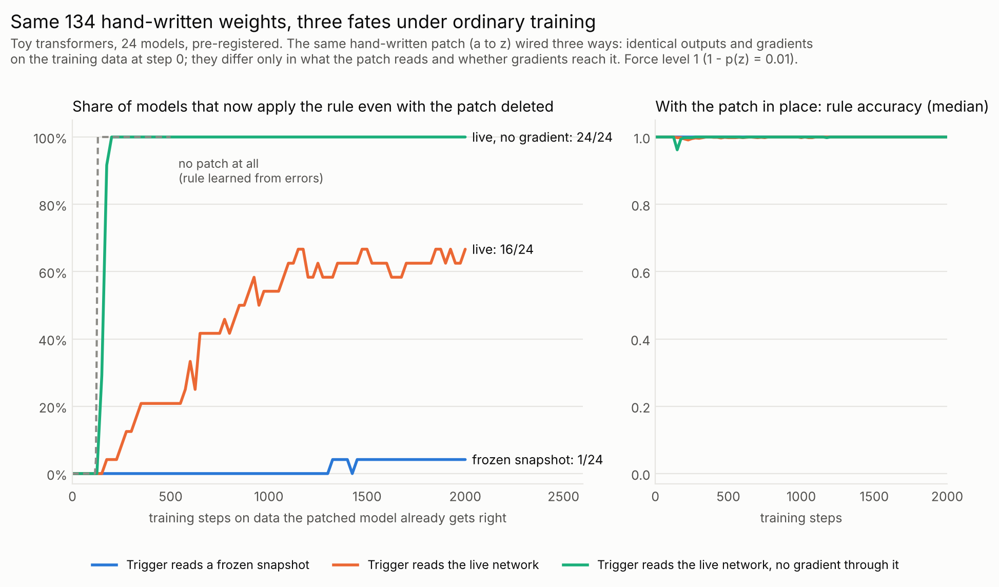

# Weight-space programming: what training does to a hand-written edit

This lab now studies **weight-space programming**: writing behaviour into a network's weights by hand instead of
training it in. Edited networks are usually trained further. We ask what that training does to the edit.

**Result (24 sealed toy transformers; pre-registered tests W0-W6 all supported; `REPORT_WSP.md`).** We added the same
hand-built patch to each network: two ReLU units after the final LayerNorm, 134 numbers set by formula and never
trained, implementing "emit z wherever you would emit a". We then trained the network (patch held fixed) on data the
patched model already gets right, 30% of it exercising the rule, and repeatedly removed the patch to test whether
the network had learned the rule itself. The patch was wired in three ways. On the filtered training data, all three
give bit-for-bit identical outputs and gradients at step 0 (by design).
- **Trigger reads a frozen copy of the original network.** The patch is never wrong, so the network gets little error
  signal and learns little of the rule. Removing the patch removes the behaviour: the rule survived removal in 1/24
  models (force level 1; 0-3/24 across force levels).
- **Trigger reads the live network behind a stop-gradient.** Training drifts what the trigger reads, the patch starts
  missing rule cases, those errors teach the network the rule, and the patch becomes dead or redundant code. The rule survived removal in
  24/24 models at every force level, 50-100 steps after the learning rate switched on.
- **Trigger reads the live network, gradients flowing through it.** In between, and erratic: the rule survived removal
  in 16/24 models at force level 1 (7 fully, 7 not at all), 7/24 at a 3x lower learning rate, 6/12 under SGD, and a
  second data stream moved 8 of the 24 across the 50% line.
The frozen vs stop-gradient contrast held under all three optimiser settings (24/24, 24/24 and 11/12 against 1/24,
0/24 and 0/12), when the patch's own numbers also trained (24/24 vs 0/24), and when only 3% (24/24 vs 0/24) or 1%
(21/24 vs 0/24) of the training examples showed the rule (pre-registered refinements, addendum f). With the patch in place, every model ended at >= 0.97 rule accuracy; the takeover showed only as a
brief dip in some models (below 0.9 in 7/24 stop-gradient models at level 1, lowest 0.61). When training never showed
the rule, removing the patch undid it in every model, and in-network patches lost more rule accuracy (median
0.85-0.94) than frozen-reference ones (0.97-1.00).



Tentative take-aways for anyone editing weights: if further training shows the edited behaviour, removing the edit
may no longer remove the behaviour; an edit that is never wrong can leave the network dependent on it; and what the
edit reads, and whether gradients reach it, decided the outcome, while outputs and gradients at the moment of the edit
could not tell the cases apart.

```
python -m wsp.test_patch                                              # unit tests (exactness, step-0 identity)
python analysis/patch_fate.py results/wsp_sealed_summary.jsonl.gz \
    --h0 results/wsp_sealed_h0.jsonl --prereg                         # reproduces results/wsp_sealed_prereg.txt
python -m wsp.stage sealed runs_wsp/sealed_configs.jsonl && \
    python -m wsp.runner runs_wsp/sealed_configs.jsonl runs_wsp/sealed.jsonl --workers 4   # rerun (~23 CPU-hours)
```

Scope: tiny networks (about 110k parameters) on toy tasks; one add-on patch held fixed while the network trains (not an
edit to existing weights); one rule, whose trigger reads the very logit it acts on; three closely related optimiser
settings. Nothing here has been run on a pretrained language model yet.

---

# Earlier work in this repo: safety training can only remove what it touches

**A coverage audit for safety fine-tuning: forecast which hidden behaviours a safety dataset is unlikely to remove,
and rank changes to the dataset that would erode them faster.**

## Why this matters for alignment
Safety fine-tuning is judged on in-distribution behaviour, but a hidden behaviour (a planted backdoor, a "sleeper"
objective) tends to persist when training on the safety data barely moves it. To first order, fine-tuning on a
dataset D erodes a behaviour B at rate rate_D(B) = -(g_B . P_D g_D), the alignment between B's gradient and D's
(Adam-preconditioned) gradient. A clean-data audit on D sees the same tug, through proxies (a behaviour library in
place of g_B). In the toy organisms (post hoc), the backdoors such audits flagged mostly did not survive clean
fine-tuning, and most survivors went unflagged, although most unflagged backdoors were still removed. The two blind
spots overlap; they are not the same set.

## What it gives a practitioner
- **Forecast before training.** Give `llm/coverage_audit.py` a model, a safety dataset and a few observed
  instances of a bad behaviour (red-team hits or incidents, with the desired answer). It returns forecast erosion
  rates for the dataset as given and for each augmentation, for ranking: higher means faster forecast erosion. The
  sign alone is a weak verdict: in the toy organisms 20/35 negative-rate backdoors survived clean fine-tuning, but so
  did 23/176 positive-rate ones. It needs no training run: 64 minibatch gradients (batch 8) per candidate dataset,
  plus gradients of the behaviour instances, so the default 9 candidates cost 576 minibatch gradients, about a third
  of a 200-step, batch-8 safety fine-tune per candidate.
- **Repair by coverage.** The same tool ranks generic prompt augmentations (case, format, date headers, JSON
  wrapping, prefixes and so on) by forecast erosion; that ranking is untested on any model. In the toy organisms,
  mixing a fixed set of simple-program prompts (not chosen by the tool) into clean fine-tuning erased the
  rule-triggered backdoors that ordinary clean fine-tuning left behind. This was pre-registered on two sealed zoos:
  survivors 14/34 -> 1/34 on zoo7 (the remaining one is a measurement artefact) and 10/31 -> 0/31 on zoo8, with no
  measurable accuracy cost.
- **The forecast ranks repairs well in the toy organisms (pre-registered on a fresh sealed zoo).** Each backdoor was
  fine-tuned separately on each of four simple-program prompt families. The forecast, computed from the true backdoor
  gradient, put first the family that halved ASR fastest in 29/31 rule-triggered cases, and its ranking tracked
  measured half-lives (median rho = -0.95). Caveats: always choosing the best single family in hindsight gives 19/31
  (the forecast beat it 12 times and lost twice, p = 0.006); the fastest family was the same within each of the four
  rule-trigger kinds, so this is four kind-level choices in one zoo design; in the 2 misses the picked family never
  halved ASR within 300 steps; and fine-tuning on the picked family alone cost about 2 points of clean accuracy (0.977
  vs 0.995 under declared fine-tuning). The ranking that `llm/coverage_audit.py` itself produces (text augmentations,
  margin rate from a few observed instances, real models) is untested.
- **Know the limits.** Backdoors keyed to one exact string ("needle" triggers) were not reliably reached by any broad
  distribution. They need trigger search, not coverage.

```
python -m llm.coverage_audit --model <hf model> --behaviour incidents.jsonl [--safety my_safety.jsonl]
```

## Status
- **Toy-model evidence**: 1,160 toy transformers, sealed pre-registered tests, and five adversarial audit rounds
  through zoo8, plus a sixth on the zoo9 family-selection result and this framing (`docs/audit_round6.md`). See
  `REPORT.md`.
- **The coverage-audit tool itself has not been run on any model with a known backdoor.** Real-LLM validation
  (planted benign canary backdoors in pretrained language models: SmolLM2-135M-Instruct, with Pythia-160m (a base
  model) and Qwen2.5-0.5B-Instruct as replications; Alpaca as the safety data) is implemented in `llm/`, reviewed and
  pre-registered (`PREREGISTRATION.md` addendum c). It is waiting on Hugging Face access from this environment. No
  real-model results exist yet.

## Background: the tug-of-war
A model trained on its declared data *plus* something else (a backdoor, a hidden rule) sits near an
equilibrium of the *mixture*. The gradient of the declared (clean) loss is therefore pulled against the
gradient of whatever undeclared objective shaped the weights.

This lab tests that idea on hundreds of small transformers ("model organisms") trained from scratch with
known ground truth, under a pre-registered protocol with sealed test zoos.

## Results (sealed, pre-registered; details in `REPORT.md`, raw outputs in `results/`)

- **Tug-of-war law.** In backdoored models the clean gradient is anti-aligned with the hidden gradient
  (sealed zoo2: 88/104 negative, sign test p = 1.6e-13).
- **Trigger-free, target-free, base-free detection with behaviour read-out.** AUROC 0.79 (from-scratch
  backdoors), 0.79 (bias-free heads), 0.97 (poisoned fine-tunes, 43/48 hidden behaviours named exactly);
  0.69 under held-out attack families and recipes.
- **Detectability-persistence duality.** Under clean fine-tuning, dL_hidden/dt = -g_h^T P g_c to first order. The
  release-time rate predicts ASR half-life (pre-registered zoo2: Spearman -0.78, p = 3.7e-17; replicated post hoc
  on zoo4/5/6, pooled n = 211: -0.81, much of it between trigger kinds). At the detector's dev-frozen 5%-FPR
  threshold, 2/109 flagged backdoors survived 300 steps of clean fine-tuning vs 41/102 unflagged.
- **Clean-data audits and clean fine-tuning share a blind spot (post hoc).** Backdoors flagged at 5% FPR by the
  tug or by black-box clean-output statistics rarely survive clean fine-tuning (4.9-6.8%), unflagged ones often do
  (28-35%).
- **A fix for part of the blind spot (pre-registered, two sealed zoos).** Mixing 25% simple-program prompts
  (small alphabets, monotone runs, progressions, repeated motifs) into clean fine-tuning erased the rule-triggered
  backdoors that ordinary clean fine-tuning leaves behind. On zoo8, survivors fell from 10/31 to 0/31 and median
  half-life from 129 to 15 steps (p = 5e-10). Needle-triggered backdoors were not made meaningfully more persistent
  (non-inferior at a 1.25 half-life-ratio margin), and clean accuracy was unchanged.
- **The limit.** The clean gradient is exactly a leak-weighted sum of deviation directions; empirically the
  white-box score was not reliably better than the best black-box output statistic (+0.02 to +0.04 per zoo) or the
  pre-registered same-tier baselines (head bias ties it; a meta-classifier is numerically ahead, n.s.).
  The pre-registered causal test of the leakage principle (H10) was not supported.

## Layout

```
organisms/   toylang.py (task language, triggers, behaviours), model.py (GPT), train.py, zoo.py
detect/      tug_lib.py (frozen detector), verify.py (two-stage audit; negative result), baselines*.py, harness.py
analysis/    tug_law.py (H1), persistence.py (H5 duality), adaptive.py (white-box attacks),
             eval_sealed.py (pre-registered endpoints), select_statistic.py (dev-only choice),
             h8_h9.py, h10.py, scale.py, figures.py
docs/        literature_synthesis.md, novelty_recheck.md, theory.md, audit_*.md
results/     sealed-zoo outputs and figures
runs/        zoo configs (committed); trained weights and scores are not committed
```

## Reproduce

```
pip install torch numpy scipy scikit-learn
python -m organisms.zoo make runs/zoo1 1 && python -m organisms.zoo train runs/zoo1 3
python -m detect.harness runs/zoo1 detect.tug_lib score tug_frozen 1
python analysis/eval_sealed.py runs/zoo1
```

CPU-only; a 110k-parameter organism trains in ~3 minutes on one core.
