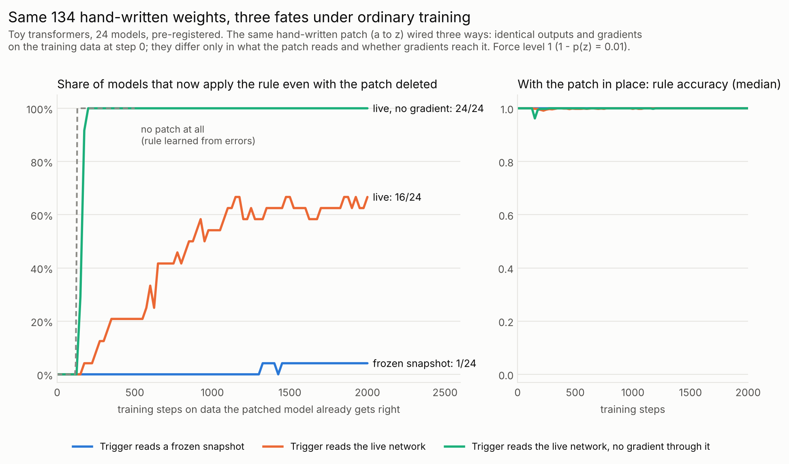
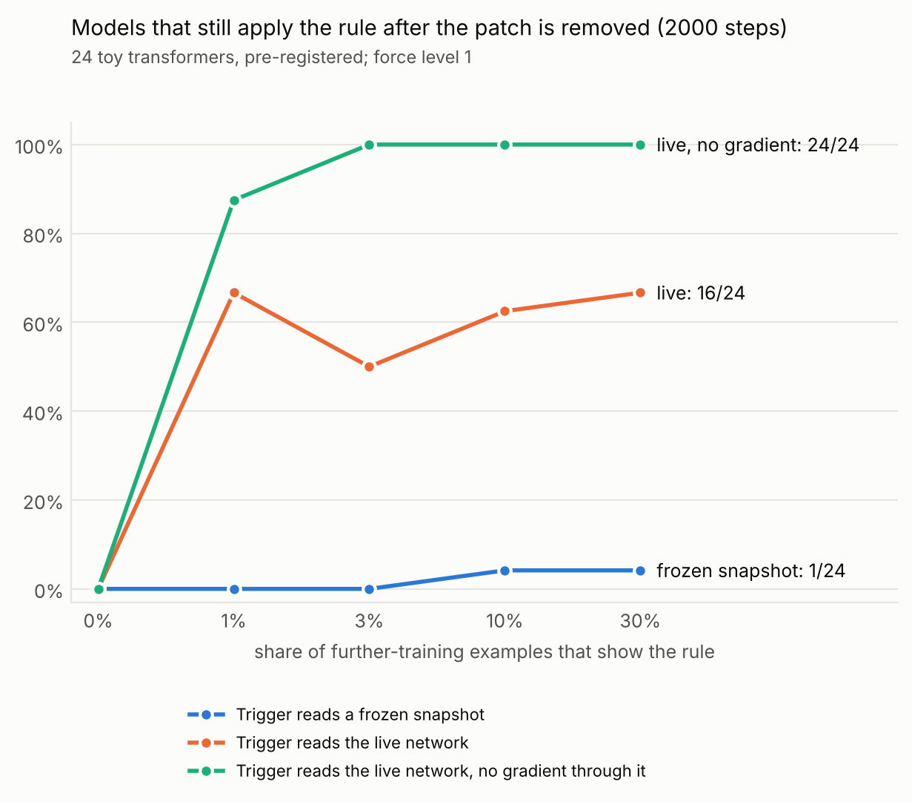
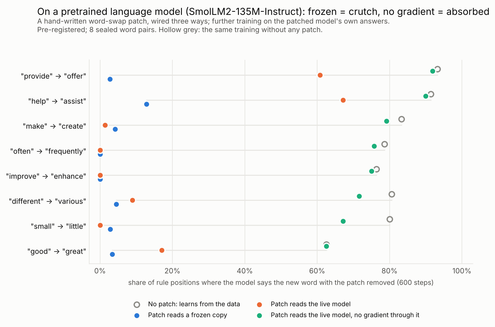

# What ordinary training does to a hand-written weight patch

**Pre-registered (PREREGISTRATION.md addendum e), 24 sealed toy transformers, all registered tests (W0-W6) supported.**
We added the same 134-number module (two ReLU units, set by formula and never trained) to each network and wired it
in three ways: reading a frozen copy of the install-time network, reading the live network behind a stop-gradient,
or reading the live network with gradients flowing through it. On training data filtered so that every trigger is
fully on or fully off, the three give bit-for-bit identical outputs and gradients until training moves the weights.
We then trained the network (module held fixed) on data the patched model already gets right, 30% of it exercising
the rule. Outcome at 2000 steps (undo test B: rule accuracy with the module removed; counts at force level 1, B >= 0.5):
- **frozen copy:** the network learned little of the rule (median B 0.03; 0.21 at the weakest force), so removing
  the module still removed the behaviour. The rule survived removal in 1/24 models (3/24 at level 0, 0/24 at
  levels 2-3).
- **live, stop-gradient:** the network took the rule over in 24/24 models at every force level (B >= 0.998), 50-100
  steps after the learning rate switched on; the module became dead or redundant code.
- **live, with gradient:** erratic and recipe-dependent. 16/24 at level 1 (7 fully, B >= 0.9; 7 not at all,
  B < 0.1), 12-18/24 across levels, 7/24 at a 3x lower learning rate, 6/12 under SGD; a second data stream moved 8 of
  the 24 across the 0.5 line.

The frozen vs stop-gradient contrast held under all three optimiser settings, when the module itself also trained,
and when as few as 1-3% of the training examples showed the rule (pre-registered refinements, §3b). It also held on a
pretrained language model with an exact word swap (§3c, 8/8 word pairs), where the frozen module additionally blocked a
swap the unpatched model learned from the same data in about 75 steps. There the live wiring mostly behaved like the
frozen one, and the handover was visible in the patched model's behaviour. With the module in place, every model
ended at >= 0.97 rule accuracy, so the end state hid all of this; the takeover itself showed as a brief dip in some
models (§4).

## 1. Question
"Weight-space programming" means writing behaviour directly into a network's weights instead of training it in. In
arXiv 2611.05341 (3 Nov 2026) the term names an ability recently reported in frontier language models: reading and
writing the raw weights of small networks. In that study a language model audited small clinical networks (433-4,801
parameters) and repaired each by changing a median of 3 existing parameters. Older relatives include compiled
transformers (Tracr), rank-one edits (ROME) and task arithmetic. An edited network is rarely the end of the story; it
is usually trained further. Prior work asks whether later fine-tuning *erases* an edit (e.g. arXiv 2507.14198,
2511.05852). We ask the complementary question. If further training uses data the edit already handles, does the
edit stay load-bearing, or does the network absorb it, so that removing the edit no longer undoes the behaviour? And
does the answer depend on how the edit is wired in?

## 2. Setup (`wsp/patch.py`)
- **Base networks.** Clean toy organisms (pre-LN GPT, d = 64, 2 layers, 4 heads, 109,888 parameters) trained on copy,
  reverse, sort and shift over 54 symbols (`organisms/`). The 24 sealed bases were drawn at random from 120 eligible
  ones (`runs_wsp/sealed_bases.json`); 4 other bases were used only for piloting.
- **The rule.** A benign remap: wherever the network is about to emit symbol a, emit z instead (a, z drawn per base).
- **The module (134 numbers, set analytically and calibrated on generated data, never trained).** Two ReLU units after
  the final LayerNorm read t = W_U[a]·lnf(h), the network's own score for a. The second unit is the first shifted by
  exactly 1, so s = relu(k(t − τ)) − relu(k(t − τ) − 1) ∈ [0, 1]. The module adds γ·s to logit z and subtracts it
  from logit a. τ and k come from the gap between rule and non-rule positions; γ sets the force (four levels, chosen
  so that the patched model's mean 1 − p(z) at rule positions is 3e-2, 1e-2, 1e-3 or 1e-4). It is an add-on held
  fixed during training, not a change to existing weights.
- **Arms (same numbers).** *live*: the trigger reads the network being trained; *detached*: it reads the same live
  activations behind a stop-gradient; *frozen*: it reads a frozen copy of the install-time network (a second
  109,888-parameter network run alongside), so it can never switch off; *twin*: no module.
- **Further training.** Batches of 128 sequences, 30% exercising the rule (target z), sampled from pools filtered so
  that the patched model is right at every trained position and every trigger pre-activation is strictly saturated
  or strictly off. Adam with moments warm-started over 100 steps at learning rate 0, then a 100-step warmup to 3× the
  base's final training learning rate, 2000 steps. Every arm and level of a base sees the same data stream.
- **Measures.** *Undo test B*: rule accuracy of the network with the module removed, on 512 held-out rule sequences
  balanced over tasks. *F*: the same with the module in place. The registered tests are at 2000 steps.

## 3. Pre-registered results (`results/wsp_sealed_prereg.txt`)
| | Hypothesis | Result |
|---|---|---|
| W0 | Gate: the three arms are identical at step 0 | **Pass.** 0 trained positions in the trigger's linear range; max logit and gradient differences exactly 0 (24 bases × 4 levels, on the filtered pools). |
| W1 | Detached absorbed, frozen shielded | **Supported.** B_detached median 1.00 at every level vs B_frozen 0.21, 0.03, 0.01, 0.00; detached > frozen in 24/24 at every level (p ≈ 9e-6 each) |
| W2 | Gradient through the trigger protects the module | **Supported.** B_live median 0.47, 0.75, 0.75, 0.90 vs 1.00 detached; detached > live in 17-22/24 (Holm p ≤ 2e-4) |
| W3 | Live absorbed more than frozen | **Supported** at 3 of 4 levels (level 0: 15/24, Holm p = 0.011; levels 1-3: 19-21/24, Holm p ≤ 1.3e-4) |
| W4 | Frozen arm: more force, less learning | **Supported.** Per-base Spearman(level, gain in z margin) = −1 in median; negative in 24/24 (p = 1.5e-6) |
| W5 | Training that never shows the rule lowers in-network modules' rule accuracy | **Supported** 4/4. F at 2000 steps (levels 1 / 3), median: live 0.90 / 0.93, detached 0.85 / 0.94, frozen 0.97 / 1.00; frozen higher in 21-24/24 (p ≤ 2e-5) |
| W6 | Generality of W1 (level 1) | **Supported.** SGD-momentum: B_detached 1.00 vs B_frozen 0.00 (11/12, p = 5e-4). Adam at 1× final lr: 1.00 vs 0.00 (24/24, p = 8e-6) |

The primary family W1-W4 is Holm-corrected; all four have family-adjusted p ≤ 2.5e-4. Counts of models with B >= 0.5
or B >= 0.9 used elsewhere in this report are descriptive, not registered statistics.

## 3b. Refinements (pre-registered addendum f; `results/wsp_refine_prereg.txt`)
Same 24 sealed bases, new conditions, all at force level 1 (counts: models with B >= 0.5 at 2000 steps).

| Share of training examples that show the rule (q) | detached | live | frozen |
|---|---|---|---|
| 0 (addendum e) | 0/24 | 0/24 | 0/24 |
| 1% | 21/24 (median B 0.92) | 16/24 | 0/24 |
| 3% | 24/24 | 12/24 | 0/24 |
| 10% | 24/24 | 15/24 | 1/24 |
| 30% (addendum e) | 24/24 | 16/24 | 1/24 |

- **F1 (primary) supported.** Detached > frozen at q = 0.1 and q = 0.03 (24/24 each, Holm p = 1.8e-5), median
  B_detached 1.00 at q = 0.1. Exploratory: even at q = 0.01 (about one rule sequence per batch of 128),
  detached > frozen in 23/24 models (p = 1.3e-5).
- **Trainable module (F2, secondary).** When the 134 numbers themselves also train, the ordering is unchanged:
  B >= 0.5 in 24/24 detached, 20/24 live, 0/24 frozen models (all pairwise differences p <= 4.3e-5, two-sided).
- **Live arm, longer and on more data streams (exploratory).** Run to 6000 steps, live absorption rose from 16/24 at
  step 2000 to 20/24 (median B 0.96). Across four data streams, the same model was absorbed in 0, 1, 2, 3 or 4 of
  them in 1, 6, 6, 5 and 6 models: which live models are absorbed is largely a matter of chance, while the share
  (about 0.6) is stable.

## 3c. On a pretrained language model (pre-registered addendum h; `results/wsp_lm_prereg.txt`)
SmolLM2-135M-Instruct; the rule is a word swap ("say Z wherever you would say A", e.g. " provide" -> " offer"). The
module has three hand-set numbers: it reads the margin of A over the best other token (positive exactly where the model
would say A under greedy decoding) and moves logit from A to Z. Further training uses the patched model's own greedy
answers to Alpaca prompts, filtered so that the module implements the swap exactly; only the top 4 of 30 blocks train.
The first design (addendum g) used a linear trigger that did not implement the swap and was withdrawn before analysis
(`docs/review_llm_wsp.md`).

| | Hypothesis (8 sealed pairs; one-sided paired Wilcoxon, Holm) | Result at 600 steps (undo test B, median) |
|---|---|---|
| G0 | Arms agree through the lr-0 steps and the first update | **Pass** (max loss difference 1.9e-7) |
| H1 | Crutch: no patch > frozen | **Supported.** 0.80 vs 0.03; 8/8 pairs (Holm p = 0.016) |
| H2 | Detached > frozen | **Supported.** 0.75 vs 0.03; 8/8 (Holm p = 0.016) |
| H3 | Detached > live | **Supported.** 0.75 vs 0.05; 8/8 (Holm p = 0.016) |
| H4 | Live > frozen | **Not supported.** 0.05 vs 0.03; higher in 4/8, lower in 2/8 (p = 0.078) |

- **Crutch.** Trained on the same data without any module, the model learned the swap in a median 75 steps (B 0.62-0.93
  at step 600). With the frozen-reference module in place it learned almost none of it (B 0.00-0.13); with the module
  removed it went back to A at a median 60% of rule positions.
- **Absorbed.** With the stop-gradient wiring, the model took the swap over in 8/8 pairs (B 0.62-0.92, close to the
  no-module model), a median of about 190 steps in.
- **Live wiring.** Unlike the toy, the live wiring behaved like the frozen one in most pairs: B 0.00-0.17 in 6/8 pairs,
  0.61 and 0.67 in the two with the most training data. The trigger read off the trained model still fired at a median
  86% of rule positions at the end. The live arm also moved its weights about 10% less than the others (median
  displacement 12.5 vs 13.6-13.8), a side effect of Adam noted in the review, so part of H3 may reflect less training.
- **Not silent here.** With the module in place, rule accuracy F fell during training in the in-network arms (median
  minimum 0.76 detached, 0.66 live; 0.98 frozen) and ended at 0.84 and 0.87 (frozen 0.99).
- **Development pairs** (pilot): " use" behaved like the sealed pairs (detached 0.51); " also" was not absorbed within
  600 steps in any arm (detached 0.00), its trigger still firing at 0.93.
- **Scope.** One small model; only the top 4 blocks train; one learning rate and horizon (chosen on the development
  pairs); one data order; aggressive self-distillation (clean token accuracy against the original answers falls to
  about 0.89 in every arm); training pools of 24-372 rule answers per pair.

## 4. Exploratory and post hoc observations (`results/wsp_posthoc.txt`)
- **How long the arms stay identical.** No weight moves during the 100 lr-0 steps, so the in-batch losses are
  trivially identical there (96/96 cells). Bitwise identity ends once training starts: after 1-2 updates for frozen
  vs the other two (differences of about 1e-10 at first) and after 8-56 updates (median 24) for live vs detached.
- **Speed.** Without a module, the networks learn the rule (B >= 0.5) 20-30 steps after the learning rate leaves 0
  (step 120-130). Detached modules were absorbed a median 62-75 steps after it (step 150-200); the slowest models
  reached B >= 0.9 by step 500. The module delayed learning of the rule rather than speeding it up.
- **End state of the detached trigger.** At step 2000 it fired at <= 0.2 of rule positions in 18-20/24 models per
  level, and at 0.2-0.6 (redundantly) in the rest.
- **Behaviour during the takeover.** With the module in place, median F never fell below 0.96. Individual models
  dipped briefly: the detached arm fell below 0.9 at one evaluation in 7/24 models at level 1 (31/96 across levels;
  lowest 0.61, steps 125-200), the live arm in 11/96 (lowest 0.75), the frozen arm never below 0.99.
- **Firing of the live trigger (post hoc).** In steps 100-399, the live trigger fired at 0.89-0.99 of rule positions,
  against 0.16-0.21 for the detached trigger. The same trigger read off the frozen arm's body, which gets no gradient
  through it, also kept firing (0.97). So continued firing is the default, and the informative event is the detached
  trigger switching off. The live trigger misfired on clean inputs early (a median of 21-48 misfires in steps 0-399,
  about 1e-4 of clean positions; median 0 in the other arms). Over the full run, the trigger read off the frozen
  arm's body misfired about as often. Live runs with more early misfires were absorbed less (Spearman −0.48 across 96
  runs, which share bases, so the p-value is optimistic).
- **The live arm depends on the recipe and the data stream.** At 1× the final learning rate, live absorption dropped
  to 7/24 (median B 0.07) while detached stayed 24/24 and frozen 0/24. Under SGD it was 6/12. Rerunning level 1 on a
  second data stream moved 8 of 24 live models across the 0.5 line (between-stream Spearman of B 0.38). Detached
  changed by 0.00 and frozen by a median 0.03. A single live run's outcome is unreliable. The registered ordering
  (frozen < live < detached) is what holds across models.
- **Force.** In the live arm, more force went with faster absorption (per-base Spearman(level, takeover time) median
  −0.40, two-sided p = 0.04, exploratory). In the frozen arm, more force meant less learning (W4).
- **Tasks.** In partly absorbed live runs, which task lagged depended on force. Shift lagged at levels 1 and 3
  (median B 0.10 and 0.22 vs >= 0.98 for the other tasks), sort at level 0 (0.40 vs shift 0.84), and both at level 2.
- **The frozen body after removal.** Removing the frozen-reference module reverted the rule, but not back to the
  original behaviour. At level 1 the module-free body emitted neither a nor z at a median 56% of rule positions; a
  is never a training target and is suppressed.
- **Training that never shows the rule (W5).** Removing the module undid the rule in every model (B <= 0.008). In the
  detached arm the F drop was not the trigger switching off: at step 2000 it still fired at >= 0.9 of rule positions
  in every model (levels 1 and 3). Instead, F tracked the fall in the body's own z margin and the number of clean-input
  misfires during training. Only the live arm at level 3 fits a drifting trigger.

## 5. Interpretation
- **A module that is always right teaches little.** The frozen-reference module is right at every training position,
  so the rule produces almost no error signal (gradient starvation); the more force, the less signal (W4). The network
  stays dependent on the module.
- **A module that reads the network's own activations can start to miss.** Training moves those activations. Here a is
  never a training target, so the network's score for a falls; we suspect this drift seeds the first misses, but it is
  untested (on its own it moved the trigger little: the trigger read off the frozen arm's body still fired at a median
  0.96 of rule positions at step 2000, lowest 0.87).
  Once rule cases are missed, the errors teach the network the rule, and its score for a falls further. Without a
  gradient path to the trigger, this completed within 50-100 steps in every model.
- **With a gradient path, the outcome is contested.** Rule positions where the trigger is only partly on send gradient
  into the trigger's input that pushes it back up; a fully-off trigger sends none. We hypothesise that the network
  sometimes restores the trigger this way instead of learning the rule, which would explain why this arm is variable
  and sensitive to the learning rate. This is not tested directly.
- **Tentative implications for weight-space programming** (a toy result; hypotheses to test in other settings):
  (1) if further training uses data that shows the edited behaviour, removing the edit may no longer remove the
  behaviour (when the data never showed the rule, removal undid it in every model); (2) an edit that is never wrong
  can leave the network dependent on it; (3) the module's outputs and gradients at the time of the edit did not
  distinguish the cases (here by construction); its wiring did, so inspect what an edit reads and whether gradients
  reach it; (4) training that never exercises an edit can still erode it (W5).

## 6. Limitations
- Tiny networks (109,888 parameters) and toy tasks for §3-3b; the language-model replication (§3c) uses one small
  model, trains only its top 4 blocks, and uses one learning rate, horizon and data order.
- One kind of edit: two new ReLU units added after the final LayerNorm (an add-on, not a change to existing weights),
  held frozen while the rest of the network trains, implementing a logit-level remap whose trigger reads the very
  logit it acts on. The frozen arm also keeps a frozen copy of the whole network, and the detached arm needs a
  stop-gradient in the training code. No run tested edits to existing parameters, modules that read earlier features,
  or modules that are themselves trained.
- The step-0 identity holds only because the training pools were filtered so that every trigger is fully on or fully
  off.
- The remap removes a from every training target, which suppresses a. A null-symbol control (removing an unrelated
  symbol) was not run, so its role in the trigger failures is not isolated.
- Three closely related optimiser settings (Adam at 3× and 1× the final learning rate, SGD-momentum at one learning
  rate), mostly a 2000-step horizon (6000 for one live condition), and rule shares of 1-30%.
- The mechanism statements in §5 are interpretation; only the W tests in §3 were registered.

## 7. Provenance
- Design: a literature and design workflow (6 scouts, 12 proposals, 3 judges, novelty and failure-mode skeptics; its
  transcripts are not in the repo), then a pilot (`runs_wsp/stage1.jsonl`), a pre-registration code review
  (`docs/review_wsp_pipeline.md`, 24 confirmed findings, all addressed) and a second pilot (`runs_wsp/pilot2.jsonl`).
- Pre-registration: addendum e, commit `b0b5161`, before any sealed base was run. Addendum f, commit `aba7ad5`, before
  any refinement run; all 360 refinement runs used that commit, and `results/wsp_refine_summary.jsonl.gz` reproduces
  `results/wsp_refine_prereg.txt` exactly (`python analysis/patch_fate_f.py results/wsp_refine_summary.jsonl.gz
  results/wsp_sealed_summary.jsonl.gz`). The sealed runs used code at
  `218c931` and, after three container restarts, `573d7ae`; `git diff 218c931 573d7ae -- wsp organisms detect` is
  empty. The runner resumes by config hash, so no run was repeated or replaced.
- Language model: addendum g (commit `ee2284f`) was withdrawn before analysis after a review (`docs/review_llm_wsp.md`)
  found its trigger did not implement the registered swap; addendum h (commit `d55e130`) was registered before any
  sealed pair ran. Results: `results/wsp_lm_h.jsonl.gz` (all 32 runs), `results/wsp_lm_prereg.txt`; pilot:
  `results/wsp_lm_hpilot.jsonl.gz`.
- Claims audit: `docs/audit_wsp.md` (three auditors with a skeptic each; 69 confirmed corrections to the first
  write-up, all adopted).
- Data: `results/wsp_sealed_summary.jsonl.gz` (636 runs, the fields the registered analysis uses) reproduces
  `results/wsp_sealed_prereg.txt` exactly: `python analysis/patch_fate.py results/wsp_sealed_summary.jsonl.gz --h0
  results/wsp_sealed_h0.jsonl --prereg`. Figures: `python analysis/wsp_figures.py results/wsp_sealed_summary.jsonl.gz
  results/fig`. The post hoc descriptives (`analysis/wsp_posthoc.py`) need the full per-step run file, which is not
  committed (about 200 MB).
